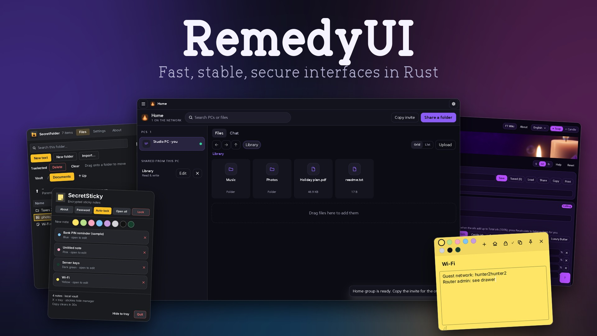
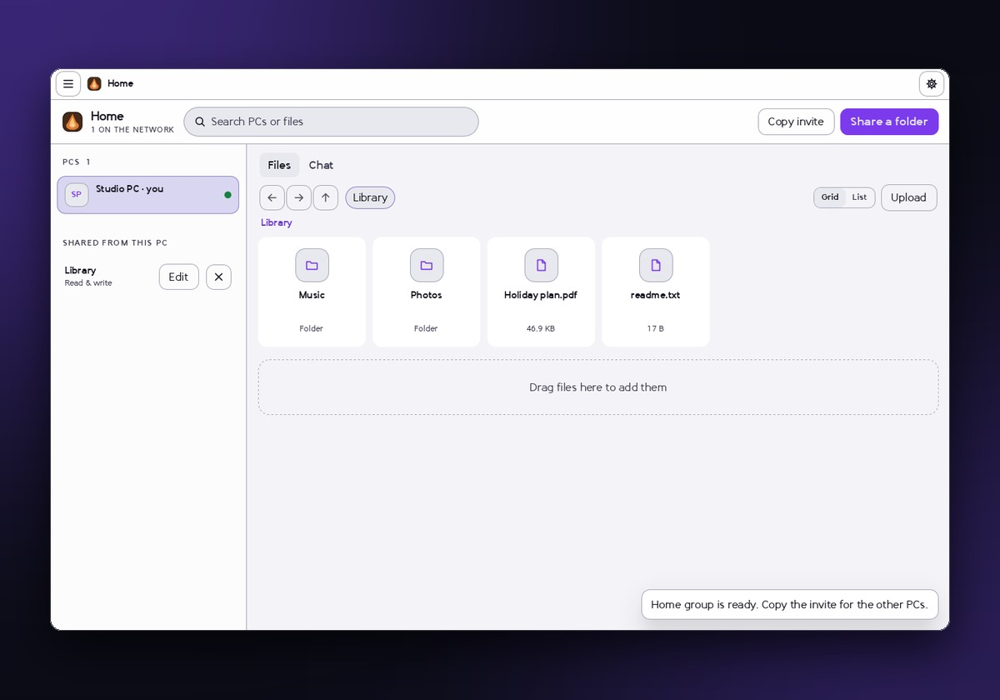
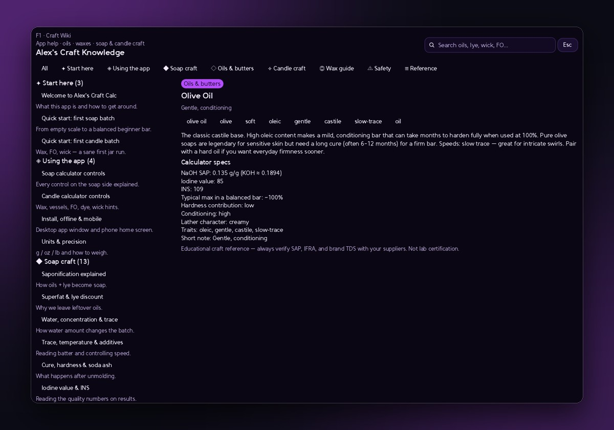
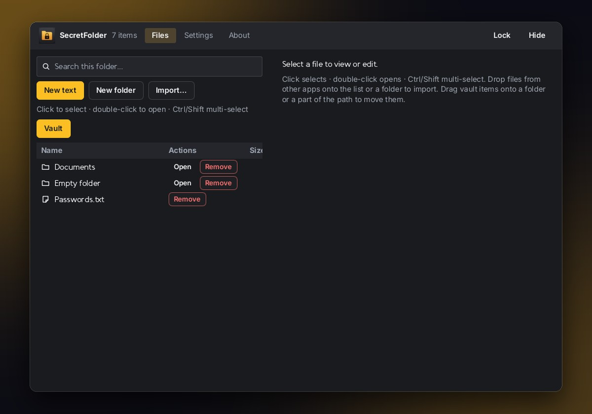
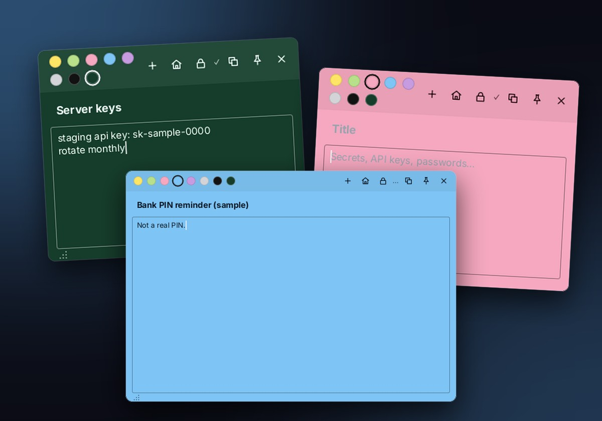
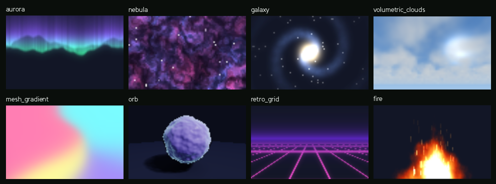

# RemedyUI



RemedyUI is the UI engine for every Remedy app, written in Rust. That covers chat, documents, notes, audio and music tools, file and secret managers, calculators, media apps, and the RemedyOS desktop. It is built to the standard of the leading UI engines (Flutter, SwiftUI, Jetpack Compose, WinUI 3, Qt Quick, the web platform). Its aims, in order: stable, secure, fast as the hardware allows, light, intuitive for the people using it, and a pleasure to build with.

**Status:** 1.0.0 release candidate.

## Apps built on RemedyUI

- [RemedyAI](https://github.com/AhmiDarrow/RemedyAI): a partner on your computer; its RemedyUI desktop and phone apps are in the repository.
- [Hearth](https://github.com/AhmiDarrow/Hearth): local file sharing and PC-to-PC chat.
- [SecretFolder](https://github.com/AhmiDarrow/SecretFolder): an encrypted folder vault for Windows and Linux that feels like a file explorer.
- [SecretSticky](https://github.com/AhmiDarrow/SecretSticky): encrypted sticky notes for Windows and Linux.
- [Alex's Craft Calc](https://github.com/AhmiDarrow/Alexs-Craft-Calc): a soap and candle calculator with a craft wiki, offline on Windows, Android and the web.

Scripted widgets run on [RemedyLua](https://github.com/AhmiDarrow/RemedyLua), a sandboxed, metered Lua 5.4 superset in safe Rust. Emoji and stickers come from [Remedy Emoji](https://github.com/AhmiDarrow/RemedyEmoji), our own original art, built into RemedyUI as a color font.

## Gallery

<table>
<tr>
<td width="50%"><br><sub><b>Hearth</b> · file sharing, light theme</sub></td>
<td width="50%"><br><sub><b>Alex's Craft Calc</b> · the built-in craft wiki</sub></td>
</tr>
<tr>
<td width="50%"><br><sub><b>SecretFolder</b> · an encrypted file explorer</sub></td>
<td width="50%"><br><sub><b>SecretSticky</b> · sticky-note windows</sub></td>
</tr>
</table>

**Prism effects**, rendered by the engine:



App pictures use sample data.

## In short

- **Retained tree with fine-grained signals.** Components run once. A state change updates only what reads it, and nothing runs while nothing changes.
- **A compositor thread.** Scrolling, animation and video stay at the display's rate even when app code is busy.
- **Modular.** Feature packs for data tables, documents, code, terminals, music widgets, media, effects, charts and platform services. An app links only what it uses, and what it links starts only when first used.
- **Real text.** Full shaping and bidi, variable and color fonts, hinting with grayscale and LCD, rich paragraphs, filled span backgrounds (inline code chips), selection across elements, rich editing, each platform's real IME, spell checking.
- **Two renderers, one display list.** A wgpu UI renderer with precompiled pipelines, and a fast CPU renderer as the floor. It recovers from a lost GPU and presents only what changed.
- **Prism effects.** Animated, procedural pictures written in `.rfx`, checked against a cost model, and drawn by a fixed GPU kernel or a CPU interpreter. Safe to load from themes and scripts.
- **Code fluid.** Users can restyle, rebind and rearrange the apps they use: themes, shortcuts and toolbars, and `.rui` layouts where an app allows it. One theme set is shared by every Remedy app.
- **Every platform as a bridge.** Windows, macOS, Linux (Wayland and X11), Android and browser pages, over one shared core.
- **Accessible, and operable by agents with consent.** One semantics tree serves screen readers, tests and AI agents.
- **Safe.** No unsafe code outside the `os`/`ffi` modules of the bridges, the GPU renderer and the few packs that call the platform themselves (updates, desktop services, spelling, media playback), checked in CI. Untrusted content is parsed by fuzzed, memory-safe code off the UI thread, optionally in a sandboxed helper. Secret inputs never leak, and there is no telemetry.

## Quick start

Install `cargo remedy`, make an app and run it:

```text
cargo install --git https://github.com/AhmiDarrow/RemedyUI cargo-remedy
cargo remedy new my-app          # templates: basic, tray, multi-window, document, android
cd my-app
cargo remedy run                 # F12 in a window opens the inspector
cargo test                       # the app on the in-memory host, and its golden previews
cargo remedy package             # Windows installer and zip; --target linux, android, macos or web
```

An app is a function that opens windows. Components run once and bind elements to signals:

```rust,no_run
use remedy_ui::reactive::Signal;
use remedy_ui::widgets as w;
use remedy_ui::{App, AppConfig, WindowSpec};

fn main() {
    let result = remedy_ui::run(AppConfig::new("Counter"), |app: &App| {
        app.open(WindowSpec::new("Counter"), |ui, _| {
            let count = Signal::new(0);
            ui.root()
                .child(w::text(ui, move || format!("Clicked {} times", count.get())))
                .child(w::button(ui, "Click", move || count.update(|c| *c += 1)).variant("primary"));
        });
    });
    if let Err(e) = result {
        eprintln!("{e}");
    }
}
```

## The guide

The guides, porting guides and recipes are part of the API docs, in `remedy_ui::guide`. Every Rust sample in them is a doctest, so `cargo test` keeps them true. Open them with:

```text
cargo doc -p remedy-ui --all-features --open
```

- **Guides:** getting started, stability and editions, thinking in signals (properties, context, persisted state), showing, failing and loading (`show`, error boundaries, suspense and resources), layout, theming and typed tokens, text and input methods, lists and virtual lists, motion and reduced motion, accessibility, testing, network (requests, JSON, keepalive and resources), packaging and updates, performance, customization (`.rui` markup and people's own layouts), agents, media, documents, the terminal, and running in a browser.
- **Porting guides** (`remedy_ui::guide::porting`): from egui, from React, from Qt or PyQt, and from pywebview or HTML apps, with their code beside ours.
- **Recipes** (`remedy_ui::guide::recipes`): chat feed, file explorer, document viewer, settings page, tray app, sticky-note windows, audio meter, unlock screen and menu bar. Each is a runnable example in [crates/remedy-ui/examples](crates/remedy-ui/examples) (`cargo run -p remedy-ui --example chat_feed`) with a headless test in [crates/remedy-ui/tests/recipes.rs](crates/remedy-ui/tests/recipes.rs). The same folder has `effects_gallery` and `glass_and_shadows` (`cargo run -p remedy-ui --example effects_gallery --features effects`).

## What is built

Apps use the facade, `remedy-ui` (`run`, `App`, `Window`, and the packs behind features). Each line below is a crate, or a part of one (`crate::module`, a module behind a feature of that crate), with real code and tests; neither joins the workspace without both.

**Foundations**
- `remedy-ui-core`: geometry, scale and snapping, colors, generational arena, and the phase spans every layer emits, with their clock
- `remedy-ui-core::reactive`: glitch-free signals, memos, effects, scopes, context, resources fetched off the UI thread, persisted signals, `Waker`, `SignalVec`, stores, and the signal graph for devtools
- `remedy-ui-macros`: `#[derive(Store)]`, `#[preview]` and `#[previews]`
- `remedy-ui-core::tree`: elements, dirty flags and boundaries, events, hit testing, focus, error boundaries
- `remedy-ui-core::testing`: the low-level headless harness

**Text, layout, style, input, accessibility, motion**
- `remedy-ui-fonts`: the Remedy families as data (Remedy Sans UI, Remedy Sans, AhmiPrint in five weights, AhmiPixel, Remedy Symbols) and Noto fallbacks for Arabic, Devanagari and Bengali
- `remedy-ui-fonts-cjk`: Noto Sans SC and Noto Sans JP, so Chinese and Japanese text never shows as empty boxes, each in its own forms of the characters they share
- `remedy-ui-text`: rich paragraph layout over parley with bidi and inline objects; hinted grayscale and LCD glyph rasterization; the glyph atlas; the editing core with undo and IME composition; secret text; deceptive-text defenses; filled span backgrounds (`TextStylePatch::background`, `SpanBackground::chip`)
- `remedy-ui-core::layout`: flex, grid and block through taffy, inherited RTL, pixel snapping, virtual lists with anchoring
- `remedy-ui-core::style`: themes as tokens, typed tokens (`Space`, `Radius`, `TextRole`, `ColorRole`), contrast-balanced derived tokens, cached style resolution, `Theme::text_scale` for a person's text size
- `remedy-ui-widgets::themes`: the twelve Remedy palettes (the colourblind ones labelled Protan, Deutan and Tritan), light and dark from the system, high contrast, design-token files, the widget style sheet
- `remedy-ui-core::input`: the event model, gesture arena, scroll physics, commands with rebindable shortcuts
- `remedy-ui-core::a11y`: semantics to incremental AccessKit updates, merging, protected fields, live regions
- `remedy-ui-core::motion`: easing, tweens, closed-form springs with interruption, the frame clock

**Rendering and the compositor**
- `remedy-ui-engine::paint`: display lists of shapes, paths, gradients, glyph runs, images, clips, layers and shadows
- `remedy-ui-engine::render_cpu`: the CPU renderer over vello_cpu with RemedyUI's own glyphs, including LCD text; the reference for golden images
- `remedy-ui-engine::render_gpu`: the wgpu renderer over vello_gpu with the same painter, a backend ladder, a pipeline cache, window surfaces and device-loss recovery
- `remedy-ui-engine::compositor`: layer trees, tiles, damage (only the tiles a content change touches are re-rastered), compositor-side scrolling and animation, progressive zoom, and the compositor thread

**The view and the platforms**
- `remedy-ui-engine::view`: elements, the frame pipeline, input routing, editable fields (plain, secret, rich and code), properties that take a value, a signal or a closure, `show`, error and suspense boundaries, element animation on the frame clock, formatted text on the clipboard, links inside text, selection across elements, the window's undo history, drag and drop within the app and with other apps, semantics
- `remedy-ui-core::host`: the platform-neutral host model every bridge implements
- `remedy-ui-platform::bridge_headless`: the host in memory, for tests, previews and servers
- `remedy-ui-platform::bridge_winit`: the shared core for the desktop and Android bridges
- `remedy-ui-platform::bridge_windows`, `remedy-ui-platform::bridge_macos`, `remedy-ui-platform::bridge_linux`: clipboard, capture protection, system settings, the tray, file dialogs, single instance, screen readers, and TSF on Windows
- `remedy-ui-bridge-web`: apps in a browser page or PWA on `wasm32-unknown-unknown`, drawn on a canvas, with the page's clipboard, links, input methods, settings and screen readers
- `remedy-ui-platform::bridge_android`: a native activity with input methods, the clipboard, links, capture protection, the safe area, back, the lifecycle, memory trims, system settings and screen readers; a Gradle-free APK build
- `remedy-ui`: the facade and runner; windows start on the CPU renderer and move to the GPU when they need it; window geometry kept per key, full-screen windows, and content that pops out to its own window
- `remedy-ui-build`: build-script help for an app's Windows icon and version information, written as a resource file (no resource compiler needed)

**Widgets**
- `remedy-ui-widgets::base`: containers, lists and virtual lists, text, buttons, choices, values, inputs, feedback, overlays, the trusted prompt, the lock screen, icons and images
- `remedy-ui-widgets::forms`: exact-decimal number input, color picker with contrast readout, key capture, calendar, date and time pickers, forms with validation and submit state, all in the user's locale
- `remedy-ui-widgets::nav`: commands and shortcuts, tabs, nav rail, breadcrumbs, a navigation stack, user-arranged toolbars, the command palette, drawers, sheets and a custom title bar
- `remedy-ui-widgets::data`: tables, icon grids, trees, property grids and chat lists, virtual at any size, with selection, editing and drag and drop
- `remedy-ui-widgets::board` and `remedy-ui-engine::script`: boards people arrange, with sandboxed scripted widgets behind one language-neutral `ScriptEngine` interface: `remedy-ui-engine::script_lua` for widgets written in RemedyLua, `remedy-ui-engine::script_wasm` for widgets compiled to WebAssembly; both measure their own speed on the device they run on
- `remedy-ui-widgets::extra`: QR codes, rating, carousel, a setup wizard flow and swatch grids
- `remedy-ui-widgets::stage`: parts for whole alternative presentations: scenes that scale art to fit with children at named anchors, pixel-art sprites written as code, orbits, path layouts, knobs and tuner dials, faders, timelines, big physical buttons and LED or split-flap boards
- `remedy-ui-widgets::music`: fretboard, chord diagram, tab staff and note staff
- `remedy-ui-widgets-term`: the terminal element: VT and xterm emulation with true color, the kitty keyboard protocol, sixel pictures, reflow, scrollback sized from the machine, selection, links, input methods and screen readers; the PTY stays in the app
- `remedy-ui-widgets::viz`: the speaking ring, level meters, sparklines and bars

Handwritten widgets run on [RemedyLua](https://crates.io/crates/remedy-lua) (`remedy-lua` 0.1.2, [repository](https://github.com/AhmiDarrow/RemedyLua)), a Lua 5.4 superset in safe Rust: fuel, memory and depth limits, an optional typed dialect (`.rlua`) and a capability-based host API. `remedy-ui-engine::script_lua` is that engine. This workspace ships the RemedyLua and WebAssembly engines above.

**Documents**
- `remedy-ui-widgets::doc_rich`: Markdown, a rich text editor with links and mentions that saves Markdown, and a find bar
- `remedy-ui-widgets::doc_pages`: paged documents over pages the app supplies, zooming from 1% to 6400% with tiles rendered off the UI thread, spreads, rotation, selection, search, thumbnails, annotations and screen reader support
- `remedy-ui-widgets::doc_code`: syntax highlighting, diffs, code views and a code editor with several cursors

**Media, effects and embedding**
- `remedy-ui-media::media_image`: images decoded off the UI thread at the size shown, color managed; with the `svg` feature, SVG at exactly the size shown, and tinted icons
- `remedy-ui-media::media_anim`: GIF, APNG and animated WebP
- `remedy-ui-media::media_isolated`: images and animations decoded in a sandboxed helper process
- `remedy-ui-media::media_video`: video surfaces fed from any thread, converted on the GPU
- `remedy-ui-media-playback`: sound and video through the platform's decoders, kept in step with the sound clock, the `player` widget, and WebVTT, SRT and ASS captions. HLS (`.m3u8` of MPEG-TS, H.264 with AAC or MP3) plays on Windows, Linux, Android and in a browser page; the macOS decoders are cross-compiled only and have not run on a Mac yet
- `remedy-ui-engine::effects`: Prism, the `.rfx` effects language, its validator and cost model, a fixed kernel library, and the CPU renderer that is the reference for the GPU kernels
- `remedy-ui-engine::media_effects`: an `.rfx` effect as an element, drawn by the GPU kernel or the CPU renderer, under the window's ambient policy
- `remedy-ui-platform::embed_gpu`: the app's own wgpu rendering as an element
- `remedy-ui-platform::embed_webview`: the platform's web view as an element, with an allow-list for every navigation, a JSON message channel, `WebView::eval`, a settable user agent, and Chrome DevTools protocol methods on WebView2 (`WebView::devtools`; WebKitGTK reports that the protocol is not available). Hosted on Windows and Linux/X11 today; macOS, Android and Wayland report `Unsupported` until those bridges host a native view

**Customization, agents and tools**
- `remedy-ui-widgets::rui`: `.rui` markup, compiled at build time or loaded at run time, and people's own layouts
- `remedy-ui-widgets::customize`: what people change about an app (their theme, shortcuts, toolbars and menus, text and screen layouts) as readable files with undo, resets and safe loading, and the editors for them
- `remedy-ui-widgets::automation`: agents reading and operating a window under the person's consent, with every change undoable
- `remedy-ui-widgets::devtools`: the inspector (F12) with the accessibility check, the signal graph, the performance overlay, Perfetto traces, remote devtools, and previews that double as golden-image tests
- `cargo-remedy`: `cargo remedy new` (basic, tray, multi-window, document and android templates), `run` (devtools, `--watch`), `package` (Windows installer and zip with signing and update signatures, Linux `.tar.gz` with the program alone for in-app updates, optional `[linux] glibc` builds through cargo zigbuild, Android APK, macOS `.app`) and `migrate` (applies the renames between releases)
- `cargo-remedy::templates`: the files of those templates, shared by `cargo remedy new` and the developer tools
- `cargo-remedy::devkit`: the logic behind the developer tools (docs, widgets, `.rui`, `.rfx`, previews, audits, tests, budgets, and a running app)
- `remedy-mcp`: the same tools over the Model Context Protocol

**Services**
- `remedy-ui-platform::services_net`: an HTTP client natively and in a browser page (JSON, headers, uploads, keepalive, and `Request` methods including `patch`)
- `remedy-ui-widgets::update`: signed updates from GitHub releases or a feed, including Tauri's multi-platform `latest.json`
- `remedy-ui-platform::services_i18n`: Fluent messages, source-keyed JSON catalogs, locale data and exact decimals
- `remedy-ui-widgets::spell`: spell checking with the platform's checker or Hunspell dictionaries
- `remedy-ui-platform::services_webstorage`: imports what a web version saved: a web view's localStorage (WebView2, Android WebView), read-only and lossless
- `remedy-ui-platform::services_desktop`: starting with the session, showing files in the file manager, the user's known folders

Checks: `cargo xtask check` (layer graph, unsafe boundary and `cargo vet`) and `cargo deny check`, alongside fmt, clippy, tests and docs.

## Tools for people and AI agents

`cargo remedy` creates, runs and packages apps, and offers developer tools:

- search the docs and the widget catalog
- check and compile `.rui` markup
- check and render Prism `.rfx` effects
- render previews as PNGs, with their accessibility audit
- run tests and the budget scenes
- operate a running app (with the person's grant) and read its devtools

`remedy-mcp` offers the same tools to AI agents over the Model Context Protocol. Both run on one logic, `cargo-remedy::devkit`, and each tool group is a feature.

```sh
cargo install --path crates/cargo-remedy
cargo install --path crates/cargo-remedy --bin remedy-mcp --features mcp-full
claude mcp add remedy -- remedy-mcp --workspace /path/to/your/apps
```

The server runs locally, over stdio (or streamable HTTP on loopback, with a token). Its tools work only in the folders you name. It reaches a running app only with the address and token of a grant you made in that app. See [docs/CLI.md](docs/CLI.md) and [docs/MCP.md](docs/MCP.md).

## Documents

| Document | What it holds |
|---|---|
| [docs/DESIGN.md](docs/DESIGN.md) | The overview: principles, engine shape, crates, stability, and the index of deep dives |
| [docs/design/](docs/design/) | Eighteen deep dives, from threads and state to text, rendering, effects, 3D, security, accessibility, developer experience and the design language |
| [docs/effects/rfx.md](docs/effects/rfx.md) | The Prism `.rfx` language, its limits and the kernel library |
| [docs/dependencies.md](docs/dependencies.md) | The third-party crates, pinned versions, and the rules for adding one |
| [docs/STABILITY.md](docs/STABILITY.md) | What 1.0 promises: semver, deprecation, editions, MSRV, which crates are stable |
| [docs/RELEASING.md](docs/RELEASING.md) | The release checks: tests and lints, `cargo xtask semver` and `msrv`, packaging |
| [CHANGELOG.md](CHANGELOG.md) | What changed in each release |
| [docs/CLI.md](docs/CLI.md) | `cargo remedy`: every command, from `new` to previews, audits and operating running apps |
| [docs/MCP.md](docs/MCP.md) | `remedy-mcp`: setup in Claude Code and other MCP clients, every tool, and the security model |

## License

RemedyUI is licensed under either of

- the [Apache License, Version 2.0](LICENSE-APACHE), or
- the [MIT License](LICENSE-MIT),

at your option. This is the usual license pair for Rust libraries. It works with FreeSpeak's AGPL-3.0, RemedyOS's Apache-2.0 and closed-source apps alike, and Apache-2.0 adds a patent grant.

Unless you say otherwise, any contribution you submit for inclusion in RemedyUI is licensed as above, without any additional terms or conditions.

"Hope this helps" - Ahmi
